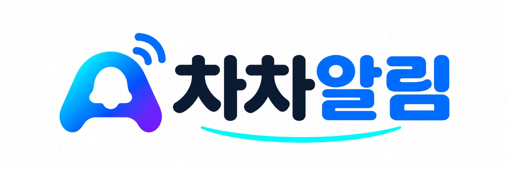
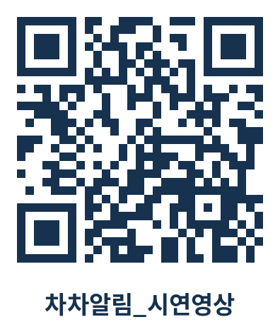
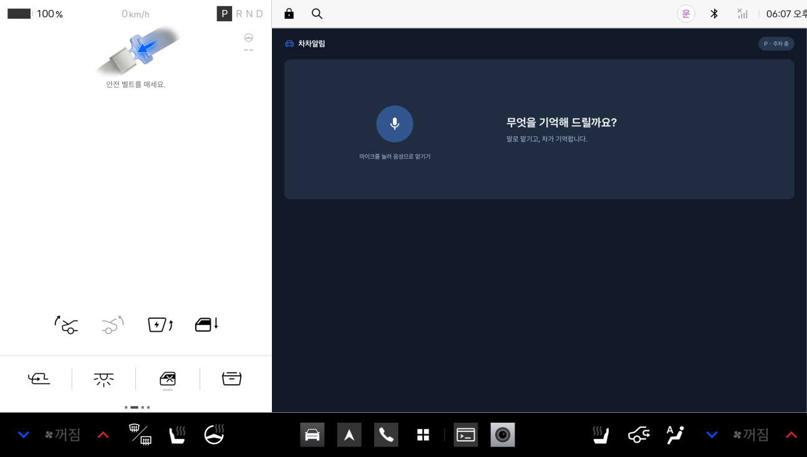
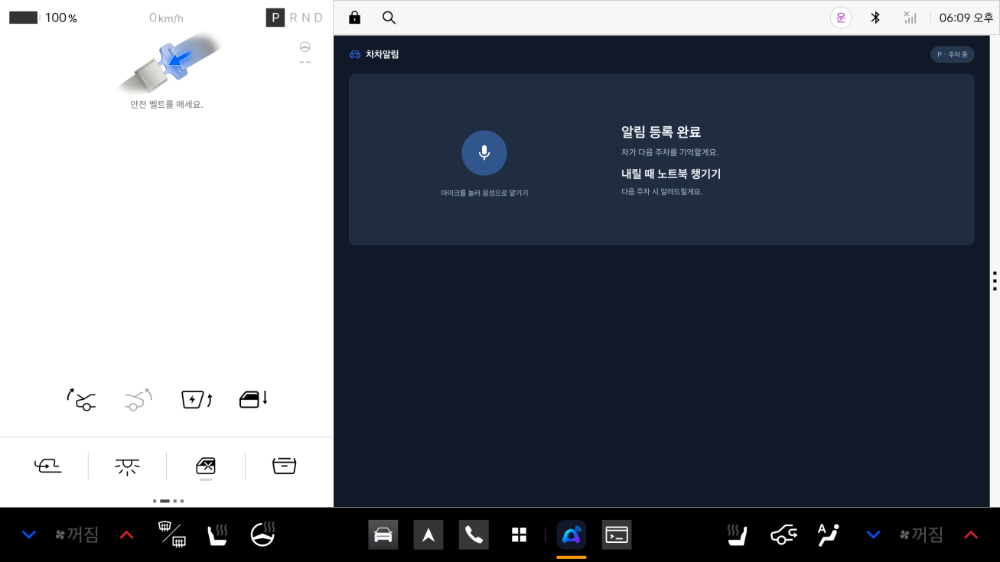
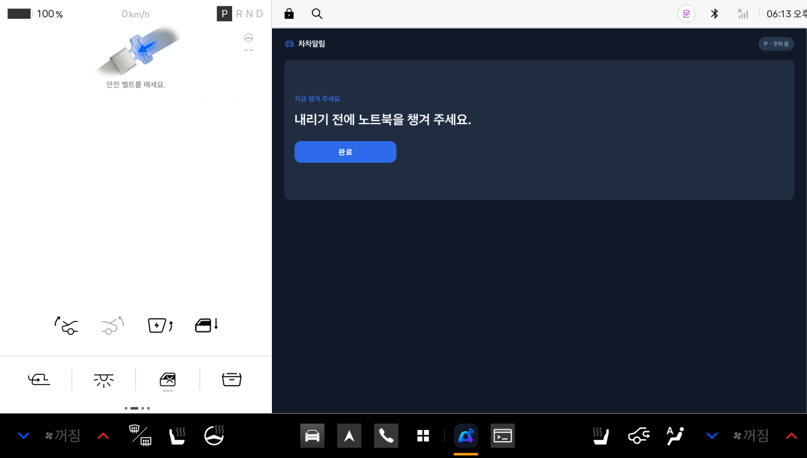
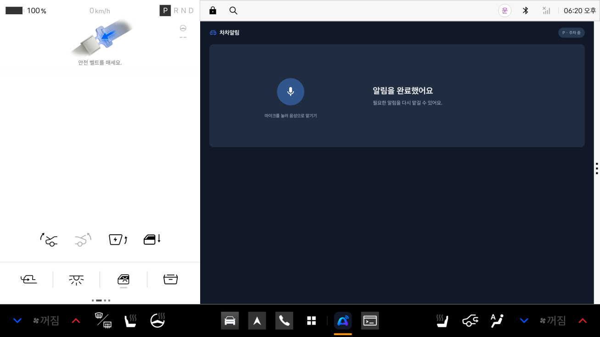

# 차차알림 (ChaCha Allim)

**말로 맡기고, 차가 기억합니다.**

부탁이나 할 일을 주차(P) 상태에서 말로 맡겨 두면, 주행을 마치고 다시 주차(P)하는 순간 차량 화면 카드와 음성으로 알려 주는 Pleos Connect 차량용 앱입니다. 운전 중에는 휴대폰을 볼 필요 없이 운전에만 집중할 수 있습니다.

> 현대자동차그룹 차량용 앱 개발 공모전 출품작 · 패키지 `com.chachaallim.app` · Android Automotive OS (Pleos Connect)
>
> *ChaCha Allim is a voice-powered in-car reminder app for Pleos Connect: say it while parked, and the car reminds you the moment you park again.*

---

## 목차

- [1. 제출물 안내](#1-제출물-안내)
- [2. 폴더 구조](#2-폴더-구조)
- [3. 앱 한 줄 소개](#3-앱-한-줄-소개)
- [4. 기획 배경](#4-기획-배경)
- [5. 해결하는 문제](#5-해결하는-문제)
- [6. 핵심 기능](#6-핵심-기능)
- [7. 실행 환경](#7-실행-환경)
- [8. 실행 방법](#8-실행-방법)
- [9. 차별성과 독창성](#9-차별성과-독창성)
- [10. 주요 사용 시나리오](#10-주요-사용-시나리오)
- [11. 구현 완료와 개발 예정](#11-구현-완료와-개발-예정)
- [12. 기대효과와 발전 가능성](#12-기대효과와-발전-가능성)
- [마치며](#마치며)

---

## 1. 제출물 안내

공모전에 제출하는 자료를 주최측 제출물 번호(01~04) 순서로 모았습니다. 심사 자료는 바로 열어 볼 수 있는 **PDF**와 원본 편집 파일인 **Word**를 함께 두었고, 시연 영상과 APK는 이 저장소에서 바로 내려받을 수 있습니다.

<table>
  <tr>
    <th nowrap>번호</th>
    <th nowrap>제출물</th>
    <th nowrap>위치</th>
    <th nowrap>QR</th>
  </tr>
  <tr>
    <td nowrap>01</td>
    <td nowrap>접수양식(기획서)</td>
    <td nowrap>앱 프로젝트 소개 · 심사 자료 – <a href="01_접수양식(기획서)/%EC%95%B1%20%ED%94%84%EB%A1%9C%EC%A0%9D%ED%8A%B8%20%EC%86%8C%EA%B0%9C%20%C2%B7%20%EC%8B%AC%EC%82%AC%20%EC%9E%90%EB%A3%8C_%EC%B0%A8%EC%B0%A8%EC%95%8C%EB%A6%BC.pdf">PDF</a> · <a href="01_접수양식(기획서)/%EC%95%B1%20%ED%94%84%EB%A1%9C%EC%A0%9D%ED%8A%B8%20%EC%86%8C%EA%B0%9C%20%C2%B7%20%EC%8B%AC%EC%82%AC%20%EC%9E%90%EB%A3%8C_%EC%B0%A8%EC%B0%A8%EC%95%8C%EB%A6%BC.docx">Word</a></td>
    <td></td>
  </tr>
  <tr>
    <td nowrap>02</td>
    <td nowrap>시연 영상<br>화면 캡처</td>
    <td nowrap><a href="02_시연영상/시연영상_차차알림.mp4">시연 영상 – 시연영상_차차알림.mp4</a> (22초, 1080p, 소리 포함)<br><a href="02_시연영상/화면캡처">화면 캡처 4장</a><br>YouTube 시연 영상 – <a href="https://youtu.be/sQOyIcJfOMw">https://youtu.be/sQOyIcJfOMw</a></td>
    <td align="center" valign="middle"></td>
  </tr>
  <tr>
    <td nowrap>03</td>
    <td nowrap>소스코드<br>APK</td>
    <td nowrap><a href="03_소스코드_APK">소스코드 – 03_소스코드_APK</a><br><a href="03_소스코드_APK/apk/사륜구동_차차알림_release.apk">APK – 사륜구동_차차알림_release.apk</a></td>
    <td></td>
  </tr>
  <tr>
    <td nowrap>04</td>
    <td nowrap>숏폼</td>
    <td nowrap>YouTube Shorts – <a href="https://youtube.com/shorts/FVd4p6Rp97Y">https://youtube.com/shorts/FVd4p6Rp97Y</a><br>채널 <a href="https://www.youtube.com/@chachaallim">https://www.youtube.com/@chachaallim</a></td>
    <td align="center" valign="middle"></td>
  </tr>
</table>

> 번호는 공모전 제출물 순서(01 접수양식(기획서) → 02 시연 영상 → 03 GitHub·APK → 04 숏폼)와 같습니다. APK는 공모전 규정에 따라 `apk/` 폴더에 있습니다.

## 2. 폴더 구조

폴더 이름 앞의 번호는 1. 제출물 안내의 번호와 같습니다. 화면 흐름은 `MainActivity.kt`, 다른 앱을 쓰는 중의 주차 감지는 `ParkingReminderService.kt`, 음성 명령 해석은 `ReminderCommand.kt`에서 볼 수 있습니다.

```text
app/
├── README.md
├── logo_차차알림.png                 README 로고
├── 01_접수양식(기획서)/               PDF · Word
│   └── 앱 프로젝트 소개 · 심사 자료_차차알림
├── 02_시연영상/
│   ├── 시연영상_차차알림.mp4
│   ├── QR_시연영상_차차알림.png       YouTube 시연 영상 QR
│   └── 화면캡처/                      앱 화면 4컷
├── 03_소스코드_APK/                   Android Studio 프로젝트
│   ├── README.md                      개발자 기능 설명서
│   ├── apk/사륜구동_차차알림_release.apk
│   └── app/src/main/
│       ├── java/com/chachaallim/app/
│       │   ├── MainActivity.kt            화면 · 음성 인식 · 알림 카드 · 다시 말하기/취소
│       │   ├── ParkingReminderService.kt  백그라운드 기어 상태 감지 · 주차 알림
│       │   ├── ReminderCommand.kt         한국어 음성 명령 해석
│       │   ├── PleosReminderSpeaker.kt    음성 안내(TTS)
│       │   ├── ReminderStore.kt           알림 · 진행 상태 저장, 완료 처리
│       │   └── GleoReminderReceiver.kt    Gleo AI 음성 명령 연동 준비
│       └── res/                           화면 레이아웃 · 아이콘 · 문구
└── 04_숏폼/
    └── QR_숏폼_차차알림.png           YouTube Shorts QR
```

---

## 3. 앱 한 줄 소개

할 일을 말로 맡겨 두면, 차가 주차하는 순간에 화면과 음성으로 다시 알려 주는 차량 전용 기억 비서 「차차알림」

- **무엇을** – 가족의 부탁, 내릴 때 챙길 물건, 도착해서 할 일
- **언제** – 주행을 마치고 기어를 다시 P(주차)에 놓는 순간
- **어떻게** – 차량 화면의 알림 카드와 음성 안내로, 휴대폰 없이

## 4. 기획 배경

- **"올 때 차에 있는 택배 꼭 가져와", "맥주는 사 와야 함"** 같은 가족의 부탁이나 "내릴 때 뒷좌석 짐(노트북, 반찬 등) 챙겨야지" 같은 챙길 일은 **차를 타고 내리는 순간**과 이어져 있습니다.
- 이를 잊지 않으려고 운전 중 휴대폰으로 메시지를 다시 확인하거나 메모하는 것은 위험합니다. 2022년 국내 교통사고의 **56.5%**가 스마트폰 사용 등 안전운전 의무 불이행으로 발생했고(손해보험협회), 시속 50km에서 **2~3초**만 한눈을 팔아도 **30~40m**를 주행합니다.
- 참으면 잊어버리고, 잊을까 봐 운전 중에도 휴대폰을 다시 보게 됩니다. 휴대폰 알림은 '시간'만 알 뿐 **'차가 멈췄을 때·내릴 때'**를 알지 못합니다.
- 「차차알림」은 주차(P) 상태에서 말로 맡겨 두면 다음 주차 순간에 알려 주어 **'운전 중 휴대폰을 잡을 이유'를 없앱니다.**

## 5. 해결하는 문제

운전자가 차 안에서 겪는 세 가지 문제를 하나의 흐름(말로 맡기기 → 주차 순간 알림)으로 함께 해결합니다.

<table>
  <tr>
    <th nowrap>문제</th>
    <th>차차알림의 해결</th>
  </tr>
  <tr>
    <td nowrap><b>1) 안전</b></td>
    <td>운전 중 할 일이 떠올라 휴대폰을 잡게 됨 → 말로 맡겨 두면 운전에만 집중합니다.</td>
  </tr>
  <tr>
    <td nowrap><b>2) 잊어버림</b></td>
    <td>챙길 짐·가족의 부탁 같은 할 일을 잊어버림 → 주차하는 순간 차가 챙겨 줍니다.</td>
  </tr>
</table>

## 6. 핵심 기능

차차알림은 **① 말로 맡기기 → ② 알맞은 순간 판단 → ③ 안전하게 전하기 → ④ 확인하고 정리하기**의 4단계로 동작합니다. 아래 화면은 모두 Pleos Connect 에뮬레이터에서 실제 앱을 실행해 캡처한 것이며, 같은 흐름을 02 시연 영상에서도 볼 수 있습니다.

<table>
  <tr>
    <td width="62%"></td>
    <td>
      <h3>① 말로 맡기기</h3>
      주차(P) 상태에서 마이크를 누르고 말하면 알림으로 등록합니다.<br><br>
      <b>구현 완료</b> · Pleos 음성 인식(STT) SDK<br><br>
      화면: 첫 화면 "무엇을 기억해 드릴까요?"
    </td>
  </tr>
  <tr>
    <td></td>
    <td>
      <h3>② 알맞은 순간 판단</h3>
      "주차하시면 알려 드릴게요"라고 답하고, 기어 P → D → P를 지켜보며 주행 후 주차한 순간을 기다립니다.<br><br>
      <b>구현 완료</b> · Vehicle(기어 상태) SDK<br><br>
      화면: 알림 등록 완료
    </td>
  </tr>
  <tr>
    <td></td>
    <td>
      <h3>③ 안전하게 전하기</h3>
      주행 중에는 알리지 않고, 다시 P단이 되는 순간 화면 카드와 음성 안내로 전합니다. 다른 앱을 쓰고 있어도 음성 안내와 시스템 알림으로 전합니다.<br><br>
      <b>구현 완료</b> · Pleos 음성 안내(TTS) SDK · 백그라운드 알림<br><br>
      화면: P단 전환 – 알림 카드
    </td>
  </tr>
  <tr>
    <td></td>
    <td>
      <h3>④ 확인하고 정리하기</h3>
      [완료]를 누르면 알림이 정리됩니다. 출발 전에는 등록된 알림을 확인하고 [다시 말하기]로 바꾸거나 [알림 취소]로 지울 수 있습니다. 음성 원본은 저장하지 않습니다.<br><br>
      <b>구현 완료</b> · 확인·다시 말하기·취소 (여러 개 알림 관리는 개발 예정)<br><br>
      화면: 완료 처리
    </td>
  </tr>
</table>

## 7. 실행 환경

심사 시 APK만 설치하면 바로 확인할 수 있도록, 앱이 동작하는 환경을 먼저 정리했습니다.

<table>
  <tr>
    <td nowrap><b>실행 환경</b></td>
    <td>Pleos Connect 에뮬레이터(Android Automotive OS) + Pleos Playground 차량 시뮬레이터(Virtual Console)</td>
  </tr>
  <tr>
    <td nowrap><b>개발 환경</b></td>
    <td>Kotlin · Gradle 9.6 · Android Gradle Plugin 9.5 · Java 11 · Android Studio · 최소/대상 API 28/37</td>
  </tr>
  <tr>
    <td nowrap><b>필요한 권한</b></td>
    <td>음성 인식·음성 안내, 차량 주행 상태(기어), 알림 표시(다른 앱 사용 중 알림), 포그라운드 서비스</td>
  </tr>
  <tr>
    <td nowrap><b>동작 범위</b></td>
    <td>다른 앱을 쓰는 중에도 기어 P → D → P를 감지해 음성 안내 + 시스템 알림 · 대기 알림은 한 번에 1개 · Pleos Connect 에뮬레이터에서 검증(실제 차량·다양한 예외 상황은 검증 예정)</td>
  </tr>
</table>

## 8. 실행 방법

기어는 Pleos Playground 차량 시뮬레이터(Virtual Console)에서 바꿉니다. 아래 순서대로 진행하면 6. 핵심 기능의 ①~④를 차례로 확인할 수 있습니다.

<table>
  <tr>
    <th nowrap>순서</th>
    <th nowrap>할 일</th>
    <th>방법 · 결과</th>
  </tr>
  <tr>
    <td nowrap>1)</td>
    <td nowrap>설치</td>
    <td>Pleos Connect 에뮬레이터를 실행하고 APK 설치<br><code>adb install 03_소스코드_APK/apk/사륜구동_차차알림_release.apk</code></td>
  </tr>
  <tr>
    <td nowrap>2)</td>
    <td nowrap>실행</td>
    <td>앱 목록에서 <b>차차알림</b>(<code>com.chachaallim.app</code>) 실행</td>
  </tr>
  <tr>
    <td nowrap>3)</td>
    <td nowrap>① 말로 맡기기</td>
    <td>기어 <b>P(주차)</b>에서 마이크 버튼을 누르고 말하기 – 예) "내릴 때 노트북 챙기라고 알려 줘" → "주차하시면 알려 드릴게요"</td>
  </tr>
  <tr>
    <td nowrap>4)</td>
    <td nowrap>② 알맞은 순간 판단</td>
    <td>차량 시뮬레이터(Virtual Console)에서 기어를 <b>P → D</b>로 바꿔 주행 (알림 없음)</td>
  </tr>
  <tr>
    <td nowrap>5)</td>
    <td nowrap>③ 안전하게 전하기</td>
    <td>기어를 다시 <b>D → P</b>로 바꾸면 화면 알림 카드 + 음성 안내</td>
  </tr>
  <tr>
    <td nowrap>6)</td>
    <td nowrap>④ 확인하고 정리하기</td>
    <td><b>[완료]</b>를 누르면 알림 정리</td>
  </tr>
</table>

> - 다른 앱을 쓰는 중에도 알림을 받으려면 알림 권한을 허용해 주세요. 이때는 음성 안내와 함께 시스템 알림이 표시됩니다.
> - 등록한 알림은 출발 전에 **[다시 말하기]**로 바꾸거나 **[알림 취소]**로 지울 수 있습니다. 인식이 어려운 표현은 다시 말하도록 안내합니다.
> - 주행 중(D단)에는 차량 정책상 앱 화면이 차단되므로, 말로 맡기기는 반드시 P단에서 합니다.
> - 소스에서 직접 빌드하려면 `03_소스코드_APK` 폴더를 Android Studio로 열고 `app` 모듈을 실행하면 됩니다.

## 9. 차별성과 독창성

기존 리마인더가 '언제(시간)'와 '어디서(위치)'를 사용자에게 묻는다면, 차차알림은 **차의 상태**를 기준으로 '알려 줄 순간'을 스스로 판단한다는 점이 가장 큰 차이입니다.

<table>
  <tr>
    <th nowrap>차별점</th>
    <th>기존 방식</th>
    <th>차차알림</th>
  </tr>
  <tr>
    <td nowrap><b>1) 차의 상태로 알림</b></td>
    <td>휴대폰 리마인더는 시간·장소(GPS)를 직접 정해야 하고, 위치 신호가 약한 지하주차장에서는 알림을 놓치기 쉬움</td>
    <td>차량에서 직접 받는 <b>기어 상태(P → D → P)</b>로 "주행을 마치고 주차한 순간"을 판단 → 말만 하면 되고 지하주차장에서도 정확</td>
  </tr>
  <tr>
    <td nowrap><b>2) 운전 중 무음</b></td>
    <td>주행 중에도 화면과 소리로 시선을 빼앗음</td>
    <td>주행 중(D단)에는 알림을 보류하고 차가 멈춘(P단) 순간에만 전함</td>
  </tr>
  <tr>
    <td nowrap><b>3) 메모가 아닌 맡기기</b></td>
    <td>음성 메모 앱은 기록만 남기고, 다시 찾아보는 일은 사용자 몫</td>
    <td>필요한 순간에 차가 먼저 알려 주고 [완료]로 정리</td>
  </tr>
  <tr>
    <td nowrap><b>4) 휴대폰 없이 해결</b></td>
    <td>메모·확인을 위해 휴대폰을 꺼내야 함</td>
    <td>맡기기·알림·완료까지 차량 화면과 음성으로 끝</td>
  </tr>
  <tr>
    <td nowrap><b>5) 사생활 보호</b></td>
    <td>카메라·상시 듣기로 상황을 감지하는 방식도 있음</td>
    <td>버튼을 눌러 말로 맡긴 일만 처리, 음성 원본은 저장하지 않음</td>
  </tr>
</table>

## 10. 주요 사용 시나리오

대표 시나리오 **"같은 상황, 다른 결과"**는 같은 부탁을 받은 같은 운전자가 차차알림을 쓰기 전과 쓴 뒤에 어떻게 달라지는지 보여 줍니다.

- **타깃(누가):** 매일 차로 이동하며 가족·일상의 부탁을 자주 받는 바쁜 30대 운전자
- **언제:** 출발 전에 받은 부탁을 맡겨 두고 운전에만 집중하고 싶을 때

<table>
  <tr>
    <th nowrap>순서</th>
    <th nowrap>장면</th>
    <th>상황</th>
    <th nowrap>차차알림 기능</th>
  </tr>
  <tr>
    <td nowrap>1)</td>
    <td nowrap><b>지난번</b></td>
    <td>"집에 올 때 차에 있는 택배 꼭 가져와!"라는 메시지를 받았지만, 집에 들어서자 "택배는?"이라는 말에 다시 주차장으로 내려갑니다.</td>
    <td nowrap>– (사용 전)</td>
  </tr>
  <tr>
    <td nowrap>2)</td>
    <td nowrap><b>이번 – 출발 전</b></td>
    <td>주차(P) 상태에서 버튼을 누르고 "주차하면 편의점 가라고 해 줘"라고 말하면, 차차알림이 "주차하시면 알려 드릴게요"라고 답합니다. 가는 동안은 운전에만 집중합니다.</td>
    <td nowrap>① 말로 맡기기<br>② 알맞은 순간 판단</td>
  </tr>
  <tr>
    <td nowrap>3)</td>
    <td nowrap><b>이번 – 도착</b></td>
    <td>아파트 지하주차장에서 <b>P단에 놓는 순간</b> "편의점에 다녀오세요"라는 음성과 카드가 나오고, [완료]를 누른 뒤 편의점에 들릅니다.</td>
    <td nowrap>③ 안전하게 전하기<br>④ 확인하고 정리하기</td>
  </tr>
  <tr>
    <td nowrap>4)</td>
    <td nowrap><b>결과</b></td>
    <td>"맥주는 샀어?" – "나를 뭘로 보고." 같은 부탁, 같은 사람이지만 <b>말로 맡겨 둔 덕분에 결과가 달라집니다.</b></td>
    <td nowrap>–</td>
  </tr>
</table>

## 11. 구현 완료와 개발 예정

핵심 흐름(①~④)과 백그라운드 알림까지 구현해 Pleos Connect 에뮬레이터에서 동작을 확인했습니다. 음성 명령과 알림 관리는 기본 기능을 먼저 구현했고, 실제 차량에서 매일 쓰기 위한 고도화와 검증을 이어 갑니다.

<table>
  <tr>
    <th nowrap>구분</th>
    <th nowrap>기능</th>
    <th>내용</th>
    <th nowrap>사용 기술</th>
  </tr>
  <tr>
    <td nowrap>✅ 구현 완료</td>
    <td nowrap>음성 알림 등록</td>
    <td>주차(P) 상태에서 음성으로 알림 등록</td>
    <td nowrap>Pleos 음성 인식</td>
  </tr>
  <tr>
    <td nowrap>✅ 구현 완료</td>
    <td nowrap>차량 상태 감지</td>
    <td>기어 P → D → P로 주행 후 주차 상황 인식</td>
    <td nowrap>Vehicle SDK</td>
  </tr>
  <tr>
    <td nowrap>✅ 구현 완료</td>
    <td nowrap>알림 · 음성 안내</td>
    <td>주차 순간 화면 알림 카드 + 음성 안내</td>
    <td nowrap>Pleos 음성 안내</td>
  </tr>
  <tr>
    <td nowrap>✅ 구현 완료</td>
    <td nowrap>완료 처리 · APK</td>
    <td>알림 완료 처리, 앱 아이콘, 빌드·서명·설치·동작 테스트</td>
    <td nowrap>–</td>
  </tr>
  <tr>
    <td nowrap>✅ 구현 완료</td>
    <td nowrap>백그라운드 알림</td>
    <td>다른 앱을 쓰는 중에도 기어 P → D → P를 감지해 음성 안내 + 시스템 알림</td>
    <td nowrap>포그라운드 서비스 · Vehicle SDK</td>
  </tr>
  <tr>
    <td nowrap>✅ 구현 완료</td>
    <td nowrap>저장</td>
    <td>알림과 진행 상태를 앱 내부에 저장, 음성 원본 미저장</td>
    <td nowrap>앱 내부 저장소</td>
  </tr>
  <tr>
    <td nowrap>🔶 일부 구현</td>
    <td nowrap>음성 명령 확장</td>
    <td><b>구현:</b> 다양한 한국어 표현 처리, 인식이 어려우면 다시 말하도록 안내<br><b>고도화:</b> 무엇을·언제·누구에게를 자연어로 해석하는 범위 확대</td>
    <td nowrap>Pleos 음성 인식</td>
  </tr>
  <tr>
    <td nowrap>🔶 일부 구현</td>
    <td nowrap>알림 관리</td>
    <td><b>구현:</b> 등록된 알림 확인, 다시 말하기로 교체, 알림 취소<br><b>고도화:</b> 여러 개 알림 관리, 다시 알림</td>
    <td nowrap>–</td>
  </tr>
  <tr>
    <td nowrap>🔶 일부 구현</td>
    <td nowrap>UI/UX · 안정성</td>
    <td><b>구현:</b> 차량 화면 크기에 맞춘 기본 배치, 반복 주차·연속 음성 안내 테스트<br><b>고도화:</b> 다양한 화면 대응</td>
    <td nowrap>–</td>
  </tr>
  <tr>
    <td nowrap>🛠️ 개발·검증 예정</td>
    <td nowrap>차량 연동 안정화</td>
    <td>실제 차량과 다양한 주행·주차 예외 상황 검증</td>
    <td nowrap>Vehicle SDK</td>
  </tr>
  <tr>
    <td nowrap>🛠️ 개발·검증 예정</td>
    <td nowrap>복수 알림 관리</td>
    <td>여러 개의 알림을 함께 등록·관리</td>
    <td nowrap>–</td>
  </tr>
  <tr>
    <td nowrap>🛠️ 개발·검증 예정</td>
    <td nowrap>자연어 처리 확대</td>
    <td>더 자유로운 말투와 조건 이해</td>
    <td nowrap>음성 인식</td>
  </tr>
  <tr>
    <td nowrap>🛠️ 개발·검증 예정</td>
    <td nowrap>다양한 화면 대응</td>
    <td>차종별 화면 크기·비율 대응</td>
    <td nowrap>–</td>
  </tr>
  <tr>
    <td nowrap>🛠️ 개발·검증 예정</td>
    <td nowrap>재시작 · 재부팅 테스트</td>
    <td>앱 재시작·차량 재부팅 후에도 알림 유지 검증</td>
    <td nowrap>–</td>
  </tr>
</table>

> 검증: Pleos Connect 에뮬레이터와 차량 시뮬레이터에서 기어를 P → D → P로 바꿔, 앱 화면에서와 다른 앱 사용 중 모두 화면·음성 알림을 확인했습니다. 실제 차량과 다양한 예외 상황은 아직 검증하지 않았습니다. 주행 중(D단)에는 앱 화면이 차단되어 음성 등록은 주차(P) 상태에서 합니다.

## 12. 기대효과와 발전 가능성

차차알림은 운전하는 사람을 **더 안전하게**, 그리고 **덜 깜빡하게** 만들어 줍니다. 또 "차가 지금 어떤 상태인지"를 보고 알려 주는 방식이라, 앞으로 여러 차량 서비스로 넓혀 갈 수 있습니다.

<table>
  <tr>
    <th nowrap>구분</th>
    <th>내용</th>
  </tr>
  <tr>
    <td nowrap><b>1) 사용자 가치</b><br>(쓰는 사람이 얻는 것)</td>
    <td><b>더 안전해요</b> – 할 일이 생각날 때마다 운전 중에 휴대폰을 보던 습관을 줄여, 앞을 못 보는 위험한 순간이 줄어듭니다.<br><b>덜 깜빡해요</b> – 차에서 내릴 때 물건을 두고 내리거나, 가족의 부탁을 잊어버리는 일이 줄어듭니다.<br><b>마음이 편해요</b> – 말로 맡겨 두면 차가 기억해 주니, 운전하는 동안 "잊으면 안 되는데" 하고 신경 쓸 필요가 없습니다.</td>
  </tr>
  <tr>
    <td nowrap><b>2) 타깃 고객</b><br>(주로 쓸 사람)</td>
    <td><b>핵심</b> – 매일 차로 이동하며 가족·일상의 부탁을 자주 받는 바쁜 30대 운전자<br><b>확대</b> – 운전 가능한 전 연령의 운전자<br><b>확대</b> – 가족이 함께 쓰는 차, 회사 차량을 운전하는 사람</td>
  </tr>
  <tr>
    <td nowrap><b>3) 예상 MAU</b><br>(월간 활성 사용자 수)</td>
    <td>MAU는 <b>한 달에 한 번 이상 기능을 실제로 쓰는 사람 수</b>입니다. 아래 숫자는 확정된 값이 아니라, 공개된 목표에 우리 팀의 가정을 더해 계산한 <b>추정치</b>입니다.<br><br><b>전제</b> – 차차알림은 운전자가 앱 마켓에서 따로 찾아 설치하는 앱이 아니라, 차에 <b>기본 기능으로 탑재</b>되는 것을 목표로 합니다. 그래서 "설치" 단계 없이, 탑재된 차의 운전자가 얼마나 쓰는지로 계산했습니다.<br><br><b>기준이 되는 숫자</b> – 현대자동차그룹은 차량 운영체제 Pleos Connect를 <b>2030년까지 전 세계 약 2,000만 대</b>에 탑재하는 것을 목표로 발표했습니다. 2026년 신형 그랜저부터 국내에 먼저 적용되기 시작했습니다.<br><br><b>계산 방법</b> – 탑재 차량 수 × 기능을 써 보는 운전자 30% × 그중 매달 쓰는 사람 60%(모두 가정)<br><b>① 출시 초기(국내)</b> – 국내 탑재 30만 대(가정) × 30% × 60% = <b>약 54,000명</b><br><b>② 2030년 목표 기준(전 세계)</b> – 2,000만 대 × 30% × 60% = <b>약 360만 명</b><br><br><b>뜻</b> – 처음에는 국내 일부 차종에서 시작해 약 5만 명 수준이지만, Pleos Connect를 단 차가 전 세계로 늘어나면 같은 비율로도 수백만 명이 쓰는 기능이 될 수 있습니다. 비율은 출시 후 실제 지표를 보고 다시 맞춥니다.</td>
  </tr>
  <tr>
    <td nowrap><b>4) Retention</b><br>(재사용률)</td>
    <td>Retention은 <b>기능을 처음 써 본 사람이 시간이 지나도 계속 쓰는 비율</b>입니다.<br>목표 – <b>D30 35%</b>: 처음 쓰고 30일이 지난 뒤에도 100명 중 35명이 계속 쓰는 것<br>이유 – 차를 타고 내리는 일은 거의 매일 반복되고, 차차알림은 그 순간(주차할 때)에 동작하므로 계속 쓸 이유가 생깁니다.</td>
  </tr>
  <tr>
    <td nowrap><b>5) 향후 확대</b><br>(앞으로 더할 기능)</td>
    <td><b>시동 기반 알림</b> – 다음에 차를 타는 사람이 시동을 걸면, 남겨 둔 말을 전해 줍니다.<br><b>음성 버튼 · Gleo AI 연동</b> – 화면을 누르지 않고 핸들의 음성 버튼이나 차량 AI 비서로 바로 맡깁니다.<br><b>위치 기반 알림</b> – "회사에 도착하면", "마트 근처에서"처럼 장소에 맞춰 알려 줍니다.<br><b>다국어 · 접근성</b> – 큰 글씨 카드와 외국어 음성으로 더 많은 사람이 쉽게 씁니다.</td>
  </tr>
</table>

---

## 마치며

> **말로 맡기고, 차가 기억합니다.**

차차알림은 운전자가 말로 맡긴 할 일을 차가 기억했다가, 기어를 P에 놓는 가장 알맞은 순간에 다시 알려 줍니다.
시간·위치가 아닌 **차의 상태**로 알려 주는 이 방식이 운전을 더 안전하고 편하게 만들 수 있다고 믿습니다. 끝까지 읽어 주셔서 감사합니다.
